# 右豹（YouBao）· 前端产品架构文档

> **版本**：基于改版原型 v1.0 梳理  
> **日期**：2026-04-24  
> **文档范围**：前端产品架构流程 + 全功能清单（页面级）  
> **待补充**：优先级标注（P0/P1/P2）由 CoCo 在此基础上回填  

---

## 目录

1. [产品定位与商业模型](#1-产品定位与商业模型)
2. [前端技术架构](#2-前端技术架构)
3. [用户角色与身份体系](#3-用户角色与身份体系)
4. [全局导航架构（底部 Tab）](#4-全局导航架构底部-tab)
5. [角色分支首页流程](#5-角色分支首页流程)
6. [完整页面功能清单（62 个路由）](#6-完整页面功能清单62-个路由)
7. [创作者核心用户旅程](#7-创作者核心用户旅程)
8. [共享组件库说明](#8-共享组件库说明)

---

## 1. 产品定位与商业模型

### 1.1 产品定位

**右豹**是一个面向内容创作者的**多角色内容变现平台**，连接三类核心参与方：

| 角色 | 说明 | 典型来源 |
|------|------|----------|
| **创作者** | 完成推广任务赚取佣金 | 自然流量、团长下线、MCN 旗下 |
| **导师** | 带教创作者，收取服务费+永久分成 | 资深创作者晋升 |
| **团长** | 通过社交渠道招募创作者 | 有粉丝基础的 KOL |

另有 **MCN 机构**和**平台运营**两个附属角色。

### 1.2 收益分配模型

```
项目方佣金 (100%)
  ├── 创作者到手     ~85%（扣除平台费、税）
  ├── 导师分成        9%（平台出，不影响创作者）
  ├── 团长分成        2.5%（平台出）
  ├── 平台服务费      3.5%
  └── 风险拨备        ~3%
```

### 1.3 6 大推广赛道

| 赛道 | 代表项目 | 结算模型 |
|------|----------|----------|
| 小说推文 | 番茄小说、知乎故事、悟空网文 | CPA（拉新/拉旧） |
| 短剧推广 | 红果短剧 | CPA + CPS |
| 漫剧推广 | 快看漫画 | CPA |
| 网盘资源 | 迅雷网盘、百度网盘、UC网盘 | CPA |
| 工具应用 | 剪映海外 | CPA |
| 版权分销 | 授权合作 | AUTH（T+15） |

---

## 2. 前端技术架构

### 2.1 技术栈

| 层级 | 技术 | 说明 |
|------|------|------|
| UI 框架 | React 18.3.1 | 组件化渲染 |
| JSX 编译 | Babel Standalone | 浏览器端实时编译（原型阶段） |
| 打包方式 | 自研 Bundler | Base64 + Gzip 压缩，单 HTML 文件，73 个资产 |
| 设计系统 | 自定义 `DS` Token | 统一 color / font / shadow / border |
| 设备框架 | iOS 26 Liquid Glass | 手机壳渲染，含 Dynamic Island、状态栏 |
| 路由机制 | 客户端函数式路由 | `nav('screen', ctx)` 传递跳转目标和上下文 |
| 状态管理 | React useState / useMemo | 组件内状态，无全局 store（原型阶段） |
| 数据层 | 全量 Mock | 无后端请求，所有数据硬编码 |

### 2.2 架构层次图

```
┌─────────────────────────────────────────────────┐
│                  单 HTML 文件                    │
│  ┌─────────────────────────────────────────────┐ │
│  │           iOS 设备壳容器（402×874）          │ │
│  │  ┌──────────────────────────────────────┐   │ │
│  │  │  状态栏（StatusBar）                 │   │ │
│  │  ├──────────────────────────────────────┤   │ │
│  │  │                                      │   │ │
│  │  │     当前页面（Screen）               │   │ │
│  │  │     nav('target', ctx) 驱动切换      │   │ │
│  │  │                                      │   │ │
│  │  ├──────────────────────────────────────┤   │ │
│  │  │  底部 Tab 栏（TabBar）               │   │ │
│  │  │  首页 · 变现 · 工具 · 数据 · 我的   │   │ │
│  │  └──────────────────────────────────────┘   │ │
│  └─────────────────────────────────────────────┘ │
└─────────────────────────────────────────────────┘
```

### 2.3 设计系统 Token（DS）

```javascript
DS.color.brand        // 品牌橙 oklch(0.62 0.17 45)
DS.color.bg           // 页面底色
DS.color.bgElev       // 卡片/浮层底色
DS.color.bgMuted      // 次级背景
DS.color.text         // 主文字色
DS.color.textMuted    // 次级文字
DS.color.textFaint    // 极弱文字
DS.color.border       // 描边
DS.color.divider      // 分隔线
DS.font.sans          // 正文字体（PingFang SC）
DS.font.display       // 标题字体（数字等粗体显示）
DS.shadow.sm / md     // 阴影层级
```

---

## 3. 用户角色与身份体系

### 3.1 角色全景图

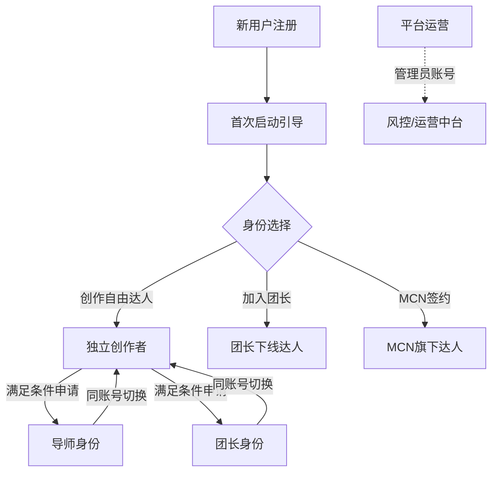

### 3.2 各角色准入条件

| 角色 | 准入条件 |
|------|----------|
| **创作者** | 实名认证即可 |
| **导师** | 累计收益 ≥ ¥5,000 + 从业 ≥ 90 天 + 实名 + 零违规 |
| **团长** | 公开社交账号 + 粉丝 ≥ 1 万 + 近30天活跃内容 + 实名 |
| **MCN达人** | MCN机构邀约签约 |
| **运营管理员** | 平台内部账号 |

### 3.3 多身份切换机制

同一账号可持有多个身份标签，在首页右上角「身份切换」入口自由切换，不同身份对应**完全不同的首页**。

---

## 4. 全局导航架构（底部 Tab）

### 4.1 底部 Tab 结构

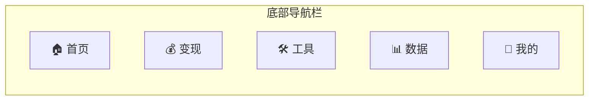

底部 Tab 为 5 个固定入口，**所有角色共用同一套底部栏框架**，但 Tab 内容根据当前身份动态渲染。

### 4.2 全局路由导航图

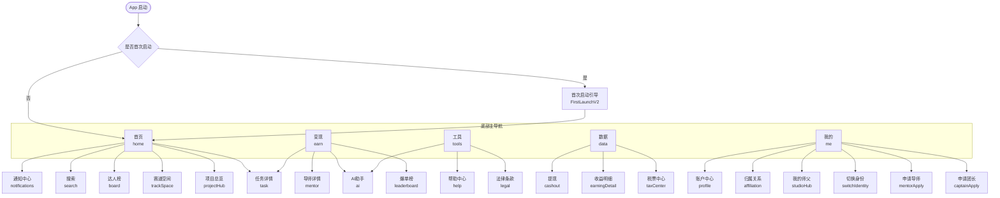

---

## 5. 角色分支首页流程

### 5.1 首次启动完整流程

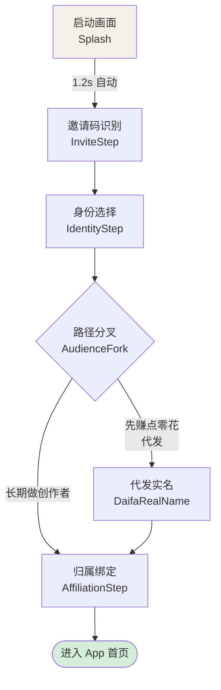

### 5.2 首页多形态分支（按组织归属）

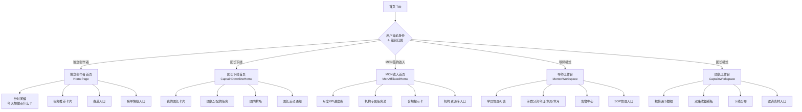

### 5.3 身份申请与切换流程

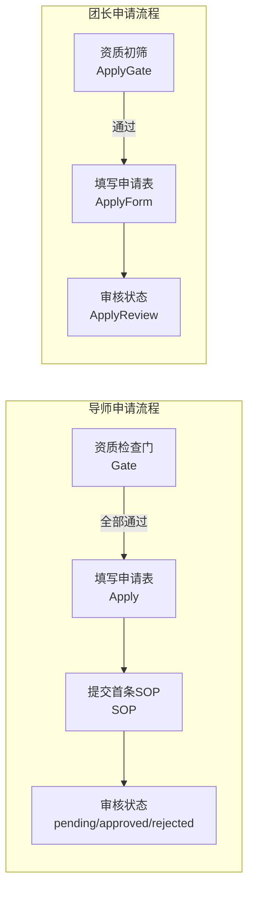

---

## 6. 完整页面功能清单（62 个路由）

> 优先级列（P0/P1/P2）待 CoCo 回填。

### 6.1 启动与引导模块

| # | 页面名称 | 路由 Key | 功能描述 | 优先级 |
|---|----------|----------|----------|--------|
| 1 | 启动画面 | `splash` | 品牌 Logo 动画，1.2s 后自动跳转 | — |
| 2 | 邀请码识别 | `inviteStep` | 自动识别团长邀请码，展示团长信息卡 | — |
| 3 | 身份选择 | `identityStep` | 选择入驻身份（创作者/代发）| — |
| 4 | 路径分叉 | `audienceFork` | 长期创作 vs 先赚零花，决定后续引导路径 | — |
| 5 | 代发实名 | `daifaRealName` | 代发模式专属实名认证流程 | — |
| 6 | 归属绑定 | `affiliationStep` | 绑定团长/平台直属，确认归属关系 | — |

### 6.2 首页模块（5 种形态）

| # | 页面名称 | 路由 Key | 功能描述 | 优先级 |
|---|----------|----------|----------|--------|
| 7 | 独立创作者首页 | `home` | 分时问候 + 任务推荐 + 赛道入口 + 榜单快捷 | — |
| 8 | 团长下线首页 | `home`（CDH 变体） | 团长卡 + 团长任务 + 团内排名 | — |
| 9 | MCN 达人首页 | `home`（MCN 变体） | 月度 KPI + 机构任务池 + 合规提示 | — |
| 10 | 导师工作台 | `home`（Mentor 变体） | 学员管理 + 带教分润 + 告警中心 | — |
| 11 | 团长工作台 | `home`（Captain 变体） | 招募漏斗 + 双路收益 + 下线分布 | — |

### 6.3 变现模块

| # | 页面名称 | 路由 Key | 功能描述 | 优先级 |
|---|----------|----------|----------|--------|
| 12 | 变现工作台 | `earn` | 任务列表（按项目分组）+ 决策筛选 + 师徒信号 | — |
| 13 | 代发首页 | `earn`（Daifa 变体） | 代发工单列表，按件日结 | — |
| 14 | 项目总览 | `projectHub` | 6 大赛道汇总卡，排序：热度/增速/产值 | — |
| 15 | 赛道空间 | `trackSpace` | 导师墙 + SOP 库 + 社群 + 同学榜 + 趋势图 | — |
| 16 | 任务详情 | `task` | 结算卡 + 爆单榜 + 手风琴协议 + 接单 CTA | — |
| 17 | 任务对比篮 | `task`（多选） | 最多 3 条任务并排对比 | — |
| 18 | 代发工单详情 | `daifaOrder` | 单工单详情、完成确认 | — |

### 6.4 师徒体系模块

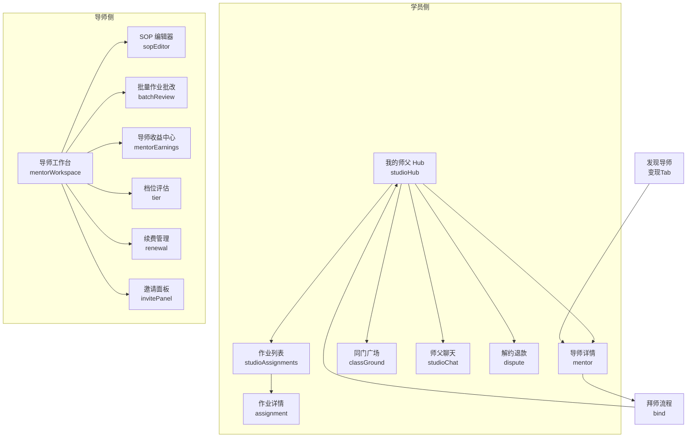

| # | 页面名称 | 路由 Key | 功能描述 | 优先级 |
|---|----------|----------|----------|--------|
| 19 | 导师详情 | `mentor` | 简介/套餐/资源/评价 四 Tab，可拜师 | — |
| 20 | 拜师流程 | `bind` | 确认 → 支付 → 成功 → 进入社群 4 步 | — |
| 21 | 我的师父 Hub | `studioHub` | 带教进度 + 作业 + 社群入口 + 解约入口 | — |
| 22 | 师父聊天 | `studioChat` | 一对一私聊（导师↔学员）| — |
| 23 | 作业列表 | `studioAssignments` | 带教期所有作业状态总览 | — |
| 24 | 作业详情 | `assignment` | 题面/我的提交/师父点评 三 Tab | — |
| 25 | 同门广场 | `classGround` | 作业墙 + 爆单榜 + Q&A 三 Tab | — |
| 26 | 解约退款 | `dispute` | 冷静期全退/合意解约/单方解约/导师失约 四情形 | — |
| 27 | SOP 编辑器 | `sopEditor` | 内容→定价→归属→预览 4 步发布 | — |
| 28 | 批量作业批改 | `batchReview` | 导师批量查看并点评学员作业 | — |
| 29 | 导师收益中心 | `mentorEarnings` | 服务分成 + 启蒙分成 + SOP 资产分成 | — |
| 30 | 导师档位评估 | `tier`（mentor）| S/A/B/C 四档，双月评估，指标进度 | — |
| 31 | 续费管理 | `renewal` | 学员续费状态，过期提醒 | — |
| 32 | 邀请面板 | `invitePanel` | 生成导师专属邀请链接/二维码 | — |
| 33 | 导师申请流程 | `mentorApply` | 资质检查 → 申请表 → SOP 提交 → 审核状态 | — |

### 6.5 团长体系模块

| # | 页面名称 | 路由 Key | 功能描述 | 优先级 |
|---|----------|----------|----------|--------|
| 34 | 团长申请 | `captainApply` | 资质初筛 → 申请表 → 审核状态 3 阶段 | — |
| 35 | 团长工作台 | `home`（CW 变体） | 招募漏斗/双路收益/下线/素材 | — |
| 36 | 下线管理 | `downline` | 下线创作者列表，活跃度/产值排序 | — |
| 37 | 团长任务 | `captainTasks` | 团长给下线分配任务 | — |
| 38 | 团长活动 | `captainEvent` | 平台给团长的专项活动/激励 | — |
| 39 | 团长榜单 | `captainLeaderboard` | 团长维度排名 | — |
| 40 | 团长档位评估 | `tier`（captain）| S/A/B/C 档位，招募规模/留存/人均 GMV | — |
| 41 | 团长收益中心 | `captainEarnings` | 招募分成（30%）+ 项目流水分成（2.5%）| — |
| 42 | 团长接管 | `captain-takeover` | 问题团长下线接管流程（运营使用）| — |

### 6.6 MCN 机构模块

| # | 页面名称 | 路由 Key | 功能描述 | 优先级 |
|---|----------|----------|----------|--------|
| 43 | MCN 达人首页 | `home`（MCN 变体）| 机构感暗色调，月度 KPI+合规 | — |
| 44 | MCN 资源池 | `mcnPool` | 机构专属任务池，高佣金项目 | — |
| 45 | MCN 资源池列表 | `mcnPools` | 全部资源池浏览 | — |
| 46 | MCN 榜单 | `mcnLeaderboard` | 机构内达人排名 | — |
| 47 | MCN 个人档案 | `mcnProfile` | 机构侧管理的达人档案 | — |
| 48 | 合规中心 | `compliance` | 合规分 + 内容审核状态（待审/待整改/已通过）| — |

### 6.7 数据与财务模块

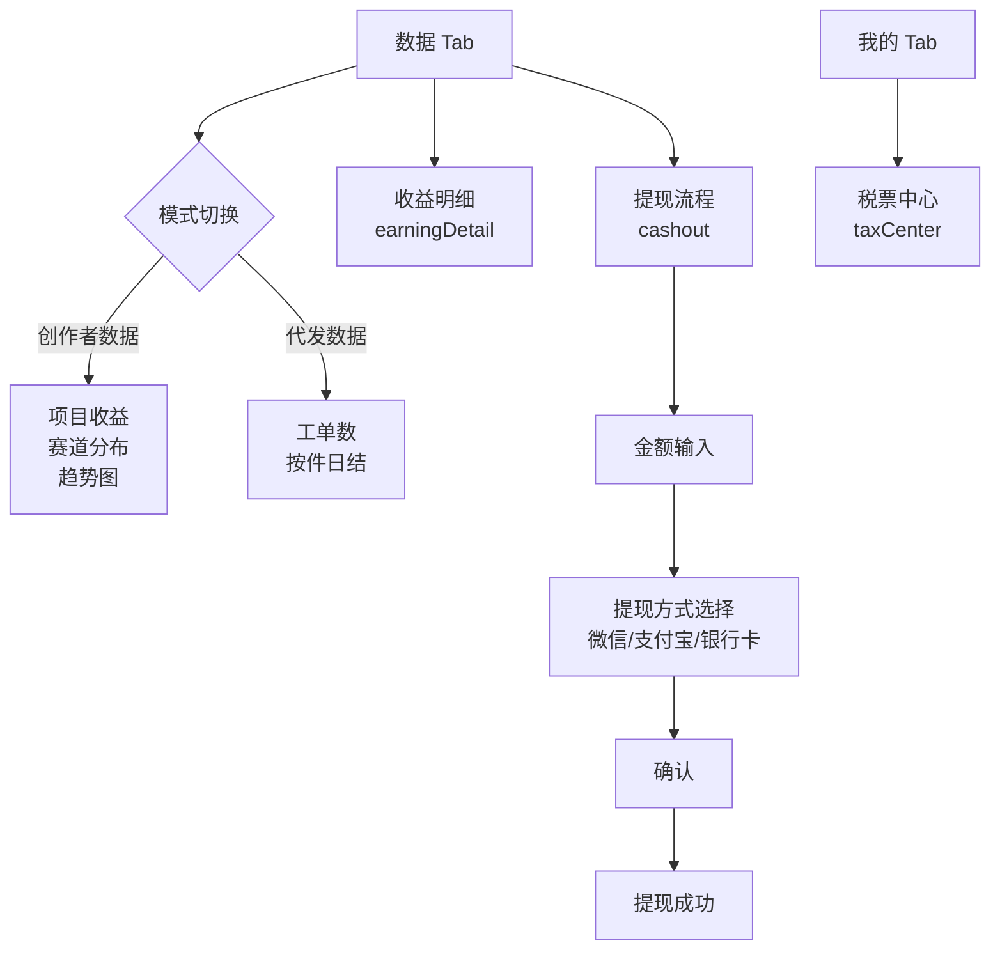

| # | 页面名称 | 路由 Key | 功能描述 | 优先级 |
|---|----------|----------|----------|--------|
| 49 | 数据仪表盘 | `data` | 创作者/代发双模，收益趋势+赛道分布 | — |
| 50 | 收益明细 | `earningDetail` | 单笔收益完整资金流：毛佣→平台费→分润→个税→到手 | — |
| 51 | 提现流程 | `cashout` | 4 步：金额→方式→确认→完成，手续费 0.6% | — |
| 52 | 税票中心 | `taxCenter` | 本年应税+开票管理+年度凭证，支持增值税普票/专票 | — |

### 6.8 榜单模块

| # | 页面名称 | 路由 Key | 功能描述 | 优先级 |
|---|----------|----------|----------|--------|
| 53 | 达人榜（v2）| `board` | 总榜/新人/黑马/师门 四维 + 赛道筛选 + 大盘数据 strip | — |
| 54 | 爆单榜 | `leaderboard` | 按平台维度，周榜/月榜，冠军高亮 | — |
| 55 | 任务排行 | `taskRanking` | 特定任务内的创作者收益排行 | — |

### 6.9 AI 与工具模块

| # | 页面名称 | 路由 Key | 功能描述 | 优先级 |
|---|----------|----------|----------|--------|
| 56 | AI 推文助手（豹赞 AI）| `ai` | 对话式文案生成：选任务→选风格→生成6条标题，一键复制 | — |
| 57 | 工具首页 | `tools` | 工具分类入口（AI工具/数据工具/素材库等）| — |
| 58 | 帮助中心 | `help` | 常见问题、客服入口 | — |
| 59 | 法律条款 | `legal` | 用户协议、隐私政策 | — |

### 6.10 运营与风控模块（管理员）

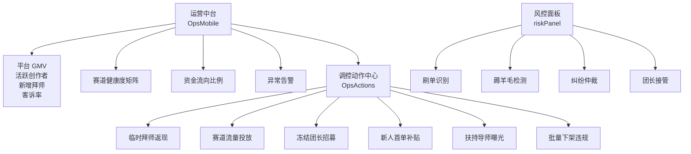

| # | 页面名称 | 路由 Key | 功能描述 | 优先级 |
|---|----------|----------|----------|--------|
| 60 | 运营中台（移动版）| `opsMobile` | GMV/赛道/资金/异常看板，快捷调控入口 | — |
| 61 | 调控动作中心 | `opsActions` | 6 类杠杆配置→影响预估→审批下发流程 | — |
| 62 | 风控面板 | `riskPanel` | 刷单识别/薅羊毛检测/纠纷仲裁/团长接管 | — |

### 6.11 账户与通用模块

| # | 页面名称 | 路由 Key | 功能描述 | 优先级 |
|---|----------|----------|----------|--------|
| — | 账户中心 | `profile` | 实名/设备/安全/客服 四组设置 | — |
| — | 归属关系 | `affiliation` | 查看并管理与团长/导师/平台的归属绑定 | — |
| — | 切换身份 | `switchIdentity` | 在已有身份间切换（创作者/导师/团长）| — |
| — | 通知中心 | `notifications` | 任务通知/带教通知/运营公告 | — |
| — | 搜索 | `search` | 全局搜索任务/导师/赛道 | — |
| — | 消息 | `messages` | 系统消息列表 | — |

---

## 7. 创作者核心用户旅程

> 以「新用户从注册到第一笔收益」为主线，覆盖关键决策节点。

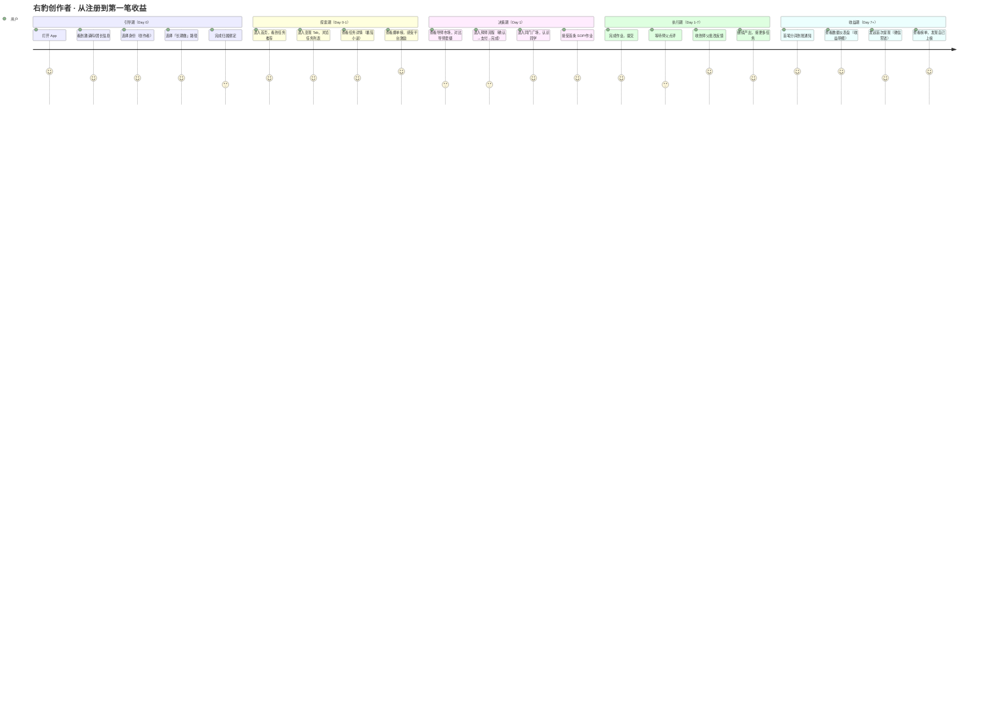

### 7.1 关键漏斗节点

```
注册
  └─ 引导完成率（完成6步引导）
       └─ 首个任务点击率（看到任务→点进详情）
            └─ 接单转化率（看任务详情→确认接单）
                 └─ 拜师转化率（看导师→完成付费拜师）
                      └─ 首单完成率（接单→提交作业/完成任务）
                           └─ 首次提现率（有收益→发起提现）
```

### 7.2 关键页面跳转路径（创作者视角）

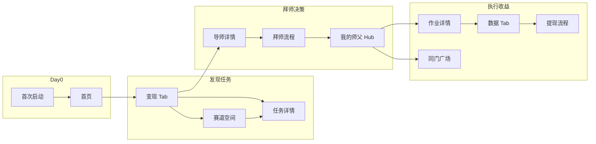

---

## 8. 共享组件库说明

### 8.1 全局共享组件

| 组件名 | 功能 |
|--------|------|
| `StatusBar` | 顶部状态栏（时间/信号/电量）|
| `TabBar` | 底部 5 Tab 导航栏 |
| `AppIcon` | App 图标组件（带圆角、颜色渲染）|
| `TaskCard` | 任务卡片（row 行式 / grid 网格 两种变体）|
| `TrackBadge` | 赛道标签（自动匹配赛道颜色）|
| `DifficultyDots` | 难度点（1-3 级）|
| `SectionHeader` | 区块标题 + 查看全部按钮 |
| `Chip` | 标签胶囊（brand/warning/success 多色）|

### 8.2 iOS 设备框架组件（UI 专用）

| 组件名 | 功能 |
|--------|------|
| `IOSDevice` | 手机壳容器（402×874，Dynamic Island）|
| `IOSStatusBar` | iOS 26 风格状态栏 |
| `IOSNavBar` | Liquid Glass 大标题导航栏 |
| `IOSGlassPill` | 毛玻璃圆角胶囊按钮 |
| `IOSKeyboard` | iOS 26 键盘渲染 |

### 8.3 Icon 系统

应用使用统一 `Icon.*` 命名空间的 SVG 图标库，包括：

```
Icon.TabHome / TabCash / TabTools / TabData / TabUser  // Tab 图标
Icon.ChevL / ChevR   // 返回/前进箭头
Icon.Bell            // 通知铃铛
Icon.Share           // 分享
Icon.Bookmark        // 收藏
Icon.Users           // 用户数
Icon.TrendUp         // 上升趋势
```

---

## 附录：路由 Key 全量索引

| 路由 Key | 对应模块 | 归属 Tab |
|----------|----------|----------|
| `home` | 首页（多形态） | 首页 |
| `earn` | 变现工作台 | 变现 |
| `tools` | 工具首页 | 工具 |
| `data` | 数据仪表盘 | 数据 |
| `me` | 我的 | 我的 |
| `task` | 任务详情 | 变现 |
| `projectHub` | 项目总览 | 变现 |
| `trackSpace` | 赛道空间 | 变现 |
| `leaderboard` | 爆单榜 | 变现 |
| `board` | 达人榜 v2 | 首页 |
| `taskRanking` | 任务排行 | 变现 |
| `mentor` | 导师详情 | 变现 |
| `bind` | 拜师流程 | 变现 |
| `studioHub` | 我的师父 Hub | 我的 |
| `studioChat` | 师父聊天 | 我的 |
| `studioAssignments` | 作业列表 | 我的 |
| `assignment` | 作业详情 | 我的 |
| `classGround` | 同门广场 | 我的 |
| `dispute` | 解约退款 | 我的 |
| `sopEditor` | SOP 编辑器 | 首页（导师） |
| `batchReview` | 批量作业批改 | 首页（导师） |
| `mentorEarnings` | 导师收益中心 | 数据（导师） |
| `mentorApply` | 申请导师 | 我的 |
| `captainApply` | 申请团长 | 我的 |
| `downline` | 下线管理 | 首页（团长） |
| `captainTasks` | 团长任务分配 | 首页（团长） |
| `captainEvent` | 团长活动 | 首页（团长） |
| `captainLeaderboard` | 团长榜单 | 首页（团长） |
| `captainEarnings` | 团长收益中心 | 数据（团长） |
| `captain-takeover` | 团长接管 | 运营 |
| `tier` | 档位评估 | 我的 |
| `renewal` | 续费管理 | 首页（导师） |
| `invitePanel` | 邀请面板 | 首页（导师） |
| `mcnPool` | MCN 资源池 | 变现（MCN） |
| `mcnPools` | MCN 资源池列表 | 变现（MCN） |
| `mcnLeaderboard` | MCN 榜单 | 首页（MCN） |
| `mcnProfile` | MCN 个人档案 | 我的（MCN） |
| `compliance` | 合规中心 | 我的（MCN） |
| `cashout` | 提现流程 | 数据 |
| `earningDetail` | 收益明细 | 数据 |
| `taxCenter` | 税票中心 | 我的 |
| `ai` | AI 推文助手 | 工具 |
| `profile` | 账户中心 | 我的 |
| `affiliation` | 归属关系 | 我的 |
| `switchIdentity` | 切换身份 | 我的 |
| `notifications` | 通知中心 | 全局 |
| `search` | 搜索 | 全局 |
| `messages` | 消息 | 全局 |
| `help` | 帮助中心 | 工具 |
| `legal` | 法律条款 | 工具 |
| `daifaOrder` | 代发工单详情 | 变现 |
| `opsMobile` | 运营中台 | 管理员 |
| `opsActions` | 调控动作中心 | 管理员 |
| `riskPanel` | 风控面板 | 管理员 |
| `projectDetail` | 项目详情 | 变现 |
| `myTasks` | 我的任务 | 变现 |
| `myTasksSettings` | 任务设置 | 变现 |
| `classmates` | 同学 | 我的 |
| `homework` | 作业 | 我的 |

---

*文档由 BMAD v6.3.0 辅助生成，输出至 `_bmad-output/product-architecture.md`*  
*下一步：请 CoCo 在功能清单「优先级」列填写 P0/P1/P2，后续可继续生成 PRD 或技术接口文档*
